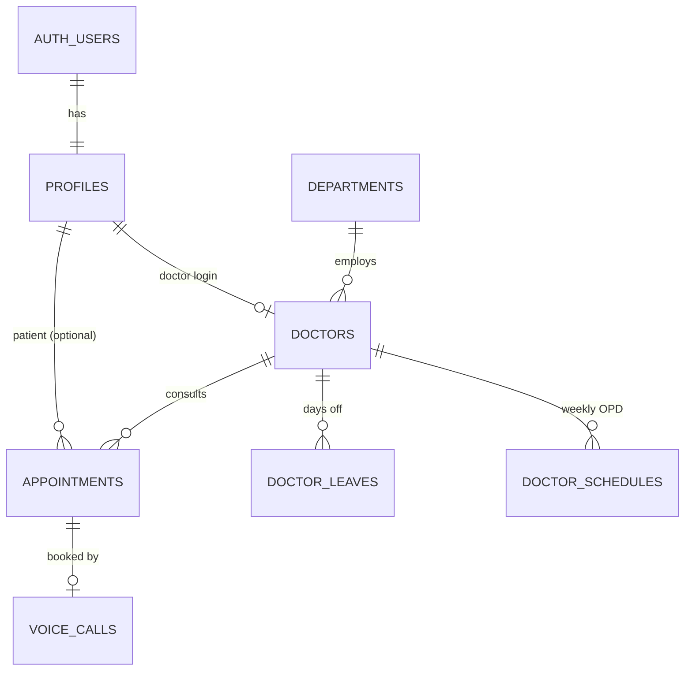

# Database Schema

The platform runs on Supabase Postgres. The schema, access rules and functions
are in `supabase/migrations/`; the initial content is in `supabase/seed.sql`.
See `SECURITY.md` for who can access what.



## Tables

| Table | Purpose |
|---|---|
| `profiles` | One row per auth user: `role` (PATIENT, DOCTOR, RECEPTIONIST, HOSPITAL_ADMIN, SUPER_ADMIN), name, contact details, `active` |
| `hospital_info` | Single row of site content (JSON matching `HospitalInfo` in `frontend/src/types.ts`) |
| `departments`, `services`, `facilities` | Public site content, with `display_order` and `active` |
| `doctors` | Public doctor profiles; `user_id` links a doctor's login |
| `doctor_schedules` | Weekly OPD sessions: day, start/end, slot length, patients per slot |
| `doctor_leaves` | Dates a doctor is unavailable |
| `appointments` | Bookings: `code` (APT-YYYYMMDD-XXXXX), daily `token_number`, `slot_time`, `status`, `source`, `notes` (JSON) |
| `voice_calls` | AI receptionist calls and the front-desk case workflow |
| `audit_logs` | Append-only log of sensitive actions |

## Functions (called from the apps)

| Function | Who | What |
|---|---|---|
| `get_available_slots(doctor, date)` | anyone | Slots with remaining capacity (next 60 days, minus leave) |
| `book_appointment(...)` | anyone | Validated, capacity-checked booking; returns a summary |
| `update_appointment_status(id, status, note)` | patient / doctor / staff | Status change with per-role rules |
| `add_appointment_note(id, text)` | doctor / staff | Append a note |
| `claim_guest_bookings()` | patient | Link earlier guest bookings made with the patient's verified mobile |
| `get_dashboard_stats()` | staff | Live KPI counts |
| `list_staff()`, `set_user_role(user, role, active)` | admins | Staff access management |

## Appointment status flow

```
NEW ──► CONTACTED ──► CONFIRMED ──► COMPLETED
 │          │             ├──────► NO_SHOW
 └──────────┴─────────────┴──────► CANCELLED
```

Guest website bookings start as `NEW` (the front desk confirms them by phone).
Bookings by signed-in patients or staff start as `CONFIRMED`.
